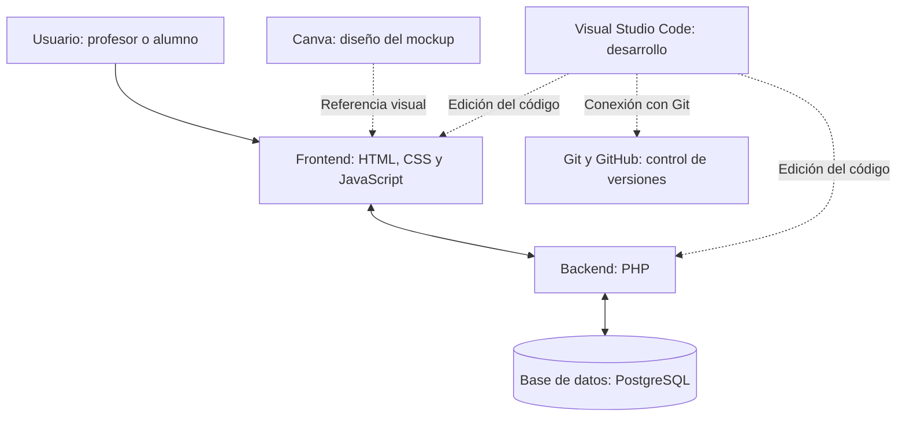

# Projecte Intermodular - [Gestión básica de tareas]

**Autor/s:Amine Boho - Amine Ayar** 
**Data:** 
**Grup:** 

---

# 1. Introducció
## 1.1 Descripcion:

- Nuestro proyecto consiste en desarrollar una aplicación web para mejorar la organización de tareas y proyectos de los estudiantes. La aplicación está diseñada para facilitar la comunicación y la gestión de los trabajos entre profesores y alumnos, permitiendo organizar las actividades de clase de una manera sencilla y eficiente.

- Los profesores podrán iniciar sesión, crear tareas con su título e información correspondiente y asignarlas a uno o varios alumnos. Por su parte, los alumnos podrán acceder a sus tareas asignadas, consultar la información de cada una y actualizar su estado para indicar si está pendiente, en proceso o completada.

- El objetivo principal del proyecto es desarrollar un Producto Mínimo Viable (MVP) que incluya las funcionalidades esenciales para comprobar el funcionamiento de la aplicación y resolver las necesidades principales de sus usuarios.

- Las funciones básicas del MVP serían:
    - 👨‍🏫 El profesor puede iniciar sesión.
    - 📝 El profesor puede crear tareas y asignarlas a los alumnos.
    - 👨‍🎓 El alumno puede iniciar sesión y consultar sus tareas.
    - ✅ El alumno puede cambiar el estado de una tarea: pendiente, en proceso o completada.

## 1.2 Usuario final (End User):

- La aplicación está dirigida a dos tipos de usuarios:

    - Profesores: podrán gestionar las tareas de clase, crear nuevas actividades y asignarlas a los alumnos correspondientes.
    - Alumnos: podrán consultar sus tareas pendientes, conocer la información necesaria para realizarlas y actualizar su progreso.

## 1.3 Problema que soluciona:

- Muchos estudiantes tienen dificultades para organizar sus tareas y proyectos, controlar las fechas de entrega y saber qué trabajos tienen pendientes. Además, la gestión de las actividades por parte de los profesores puede resultar menos eficiente cuando no existe una herramienta centralizada para crear y asignar las tareas.

- Esta situación puede provocar desorganización, olvidos y dificultades para llevar un seguimiento adecuado del trabajo escolar.

## 1.4 ¿Cómo soluciona el problema?

- La aplicación ofrece una plataforma web centralizada en la que profesores y alumnos pueden gestionar las tareas según su función. Los profesores podrán crear y asignar actividades, mientras que los alumnos tendrán acceso a sus trabajos y podrán actualizar su estado según su progreso.

- De esta manera, el proyecto busca facilitar la organización académica, mejorar el seguimiento de las tareas y ofrecer una herramienta sencilla e intuitiva para gestionar el trabajo diario en clase.

# 2. Requeriments
- En este apartado se describen los requisitos funcionales y no funcionales de nuestra aplicación web, así como las historias de usuario y la estimación de los puntos de cada una. El objetivo es definir las funcionalidades que tendrá la aplicación y las necesidades que debe cumplir para facilitar la gestión de tareas escolares.

- Requeriments **funcionals**
- Los requisitos funcionales describen las acciones que los usuarios pueden realizar dentro de la aplicación.
    
    - RF01: Permitir que los alumnos inicien sesión con su correo electrónico y contraseña.
    - RF02: Permitir que los profesores inicien sesión para acceder a la administración de la clase.
    - RF03: Permitir que los usuarios cierren sesión de forma segura.
    - RF04: Permitir que los profesores registren alumnos en la clase.
    - RF05: Permitir que los profesores creen tareas con un título y una descripción.
    - RF06: Permitir que los profesores establezcan una fecha y hora de inicio para cada tarea.
    - RF07: Permitir que los profesores establezcan una fecha y hora de entrega.
    - RF08: Permitir que los profesores asignen tareas a uno o varios alumnos.
    - RF09: Permitir que los alumnos consulten las tareas que tienen asignadas.
    - RF10: Permitir que los alumnos consulten toda la información de una tarea.
    - RF11: Permitir que los alumnos cambien el estado de una tarea a pendiente, en proceso o completada.
    - RF12: Permitir que los profesores editen la información de las tareas.

- Requeriments **no funcionals**
- Los requisitos no funcionales definen las características de calidad, seguridad y funcionamiento que debe cumplir la aplicación.
    
    - RNF01 — Seguridad: Las contraseñas deben almacenarse de forma segura.
    - RNF02 — Autenticación: El sistema debe comprobar la identidad de los usuarios antes de permitirles acceder.
    - RNF03 — Roles: La aplicación debe diferenciar entre profesores y alumnos.
    - RNF04 — Permisos: Cada usuario debe tener acceso únicamente a las funcionalidades que le correspondan según su rol.
    - RNF05 — Base de datos: La aplicación debe disponer de una base de datos para almacenar la información de los usuarios y las tareas.
    - RNF06 — Validación: Los datos introducidos por los usuarios deben validarse para evitar información incorrecta.
    - RNF07 — Usabilidad: La interfaz debe ser sencilla e intuitiva.
    - RNF08 — Diseño adaptable: La aplicación debe adaptarse a diferentes tamaños de pantalla, como ordenadores, tabletas y móviles.

!!! TIP
    Pots organitzar les User Stories en una taula:

    | ID | Com a... | Vull... | Per a... | Punts |
    |----|----------|---------|----------|-------|
    | US01 | Alumno | Iniciar sesión | Acceder a mis tareas | 3 |
    | US02 | Profesor | Iniciar sesión | Gestionar las tareas de la clase | 3 |
    | US03 | Usuario | Cerrar sesión | Proteger mi cuenta | 1 |
    | US04 | Profesor | Crear tareas | Indicar a los alumnos qué trabajo deben realizar| 5 |
    | US05 | Profesor | Asignar tareas a alumnos | Determinar quién realizar cada tarea | 5 |
    | US06 | Alumno | Consultar mis tareas | Saber qué trabajos tengo y cuándo debo entregarla | 3 |
    | US07 | Alumno | Consultar los detalles de un tarea | Conocer qué debo hacer y cuándo debo entregarla | 2 |
    | US08 | Alumno | Cambiar el estado de una tarea | Controlar mi progreso | 3 |
    | US09 | Profesor | Editar una tarea | Corregir o actualizar su información | 3 |

- Estimació de **punts** de les User Stories (28 puntos)

# 3. Estructura Git 
- Diagrama de l'estructura de branques (Gitflow, Trunk-based, etc.) amb **mermaid**
- Justificació de l'estructura triada
- Convenció de noms de branques i commits

!!! TIP BONUS POINTS
    **BONUS**:
    - Implementar git hooks (pre-commit, commit-msg) per a normalitzar missatges de commit.
    - Implementar `.gitignore` adequat al stack.
    - Ús de Conventional Commits.

# 4. Tecnologies
## 4.1 Stack tecnológico elegido
- Para desarrollar nuestra aplicación web de gestión de tareas para profesores y alumnos, utilizaremos las siguientes tecnologías y herramientas:
    - Frontend: HTML, CSS y JavaScript.
    - Backend: PHP.
    - Base de datos: PostgreSQL.
    - Diseño del mockup: Canva.
    - Editor de código: Visual Studio Code.
    - Control de versiones y trabajo colaborativo: Git y GitHub.

## 4.2 Justificación de la elección de cada tecnología
### HTML
- Utilizaremos HTML para definir la estructura de las páginas de nuestra aplicación, como el inicio de sesión, el panel del profesor y la lista de tareas del alumno.

### CSS
- Utilizaremos CSS para diseñar la interfaz de la aplicación, organizar los elementos visuales y conseguir que las páginas sean claras, intuitivas y adaptables a diferentes tamaños de pantalla.

### JavaScript
- Utilizaremos JavaScript para añadir interactividad a la aplicación y mejorar la experiencia de usuario, facilitando la interacción con las tareas y los diferentes elementos de la interfaz.

### PHP
- Utilizaremos PHP para desarrollar la parte del servidor de la aplicación. Se encargará de procesar las peticiones, gestionar el inicio de sesión, comprobar los permisos de los usuarios y realizar las operaciones relacionadas con la creación y asignación de tareas.

### PostgreSQL
- Utilizaremos PostgreSQL como sistema de gestión de bases de datos relacionales para almacenar y organizar la información de los usuarios, las tareas, las asignaciones y los estados de las actividades.

### Canva
- Utilizaremos Canva para diseñar el mockup de la aplicación antes de comenzar a desarrollar las pantallas. Esto nos permitirá planificar la distribución de los elementos y definir el aspecto visual de la interfaz.

### Visual Studio Code
- Utilizaremos Visual Studio Code como editor de código para desarrollar y organizar los archivos HTML, CSS, JavaScript y PHP del proyecto.

### Git y GitHub
- Utilizaremos Git para controlar las versiones del código y registrar los cambios realizados durante el desarrollo. GitHub nos permitirá alojar el repositorio remoto, compartir el código entre los miembros del equipo y facilitar el trabajo colaborativo.

## 4.3. Diagrama de arquitectura

# 5. Solució
- Quines pantalles s'han implementat (captures de pantalla)
- Taules de la base de dades implementades
- Lògiques de negoci principals implementades
- Funcionalitats pendents / fora d'abast (si n'hi ha)

# 6. Diagrames
- Diagrama de Dades (ER)
- Diagrama de Classes (si aplica)
- Diagrama de Seqüència d'almenys 1 procés

# 9. Conclusions
- Dificultats trobades
- Aprenentatges
- Possibles millores futures

# Annexes

## Annexe I: SCRUM
En aquest annexe s'inclourà tota la documentació relativa a la gestió del projecte, així com una imatge del Burndown chart

---
# EN EL SEGÓN TRIMESTRE
# 7. Testing
- Estratègia de proves (unitàries, integració, E2E)
- Cobertura de codi aconseguida
- Eines utilitzades (Jest, PHPUnit, Cypress, etc.)

# 8. Desplegament
- Entorn de desplegament (Docker, servidor, cloud...)
- Variables d'entorn necessàries

---

# EN EL SEGÓN TRIMESTRE
# Annexes
## Annexe II: Manual d'Usuari
Guia d'ús de l'aplicació per a l'usuari final.

## Annexe III: Manual Tècnic
Documentació tècnica addicional (API, endpoints, etc.)